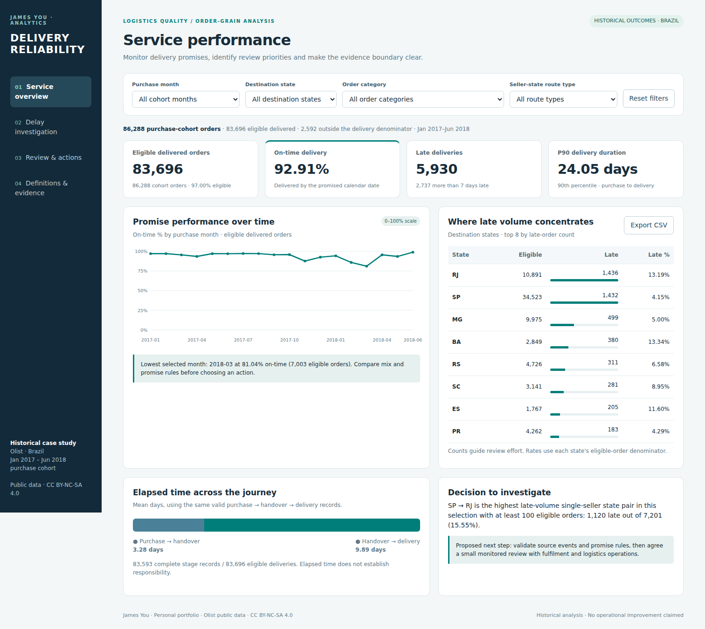

# Logistics Delivery Quality Analysis

Prioritise delivery investigations by separating promise breaches, elapsed stages and data defects.

**James You · Personal portfolio case study · SQL, Python and Power BI**



The SQL analysis and offline interactive dashboard are complete and checked. A native three-page Power BI project is included with four tables and 24 DAX measures. Its source-format checks pass; Windows Desktop refresh and native visual confirmation remain a separate acceptance step.

## The decision

An operations team needs to decide which delivery groups to investigate first, what evidence to request, and how to measure a proposed follow-up. The project turns historical orders into a service baseline and a traceable review process.

The case uses Olist's public Brazilian marketplace data. It contains no employer data and claims no implemented service improvement, parcel loss/damage measurement or realised savings.

| Baseline, January 2017–June 2018 purchase cohort | Result |
| --- | ---: |
| Orders in purchase cohort | 86,288 |
| Eligible delivered orders | 83,696 |
| On-time delivery against the estimated calendar date | 92.91% |
| Late deliveries | 5,930 |
| More than seven calendar days late | 2,737 |
| P90 purchase-to-delivery elapsed time | 24.05 days |

The on-time rate is conditional on a valid recorded delivery and promise date. The 2,592 other cohort orders remain visible in the coverage reconciliation.

## Findings that change the review

- **Prioritise volume and rate together.** SP → RJ has 1,120 late deliveries among 7,201 eligible single-seller orders, a 15.55% late rate. RJ and SP have similar total late volumes despite substantially different eligible-order volumes. The suggested next step is an event/reason review, not an attribution of carrier fault.
- **Check the customer-experience association.** Low scores occur in 9.46% of reviewed on-time orders and 79.88% of reviewed orders over seven days late. The different review denominators are shown; product mix and other factors can confound the association.
- **Define the promise correctly.** Treating a date-only estimate as a literal midnight deadline produces 6,886 late records rather than 5,930: 956 additional records were delivered later on the same estimated calendar date. The chosen calendar-date convention requires business confirmation before operational adoption.
- **Read on-time performance alongside speed and promise lead time.** The [monthly promise comparison](reports/promise_lead_time.csv) separates the estimated calendar lead time from actual elapsed delivery time. An on-time rate alone cannot establish that the experience became faster.

Read the [business case and recommendations](reports/CASE_STUDY.md) or inspect the [SQL results](reports/query_results.txt).

## Open the deliverables

- **Browser report:** open `dashboard/index.html`. It is self-contained and works offline, with purchase-month/state/category/route filters, sample thresholds, case timelines, paging and CSV exports.
- **Native Power BI:** follow [START_HERE.md](START_HERE.md). `OPEN_POWERBI.cmd` sets the local CSV path before opening the project.
- **Business analysis:** review the [requirements](docs/business_requirements.md), [investigation process](docs/investigation_process.md), [UAT](docs/UAT.md) and [proposed action register](docs/action_register.csv).
- **Methods:** read the [KPI contract](docs/kpi_contract.md), [data decisions](docs/data_decisions.md) and [data dictionary](docs/data_dictionary.md).

The screenshots here are actual captures of the browser report. Native Desktop captures are not yet available.

## Reproduce

Requires Python 3.11+ and an internet connection for the first publisher download.

```bash
python -m pip install -r requirements.txt
python scripts/build.py
python -m unittest discover -s tests -v
python scripts/run_queries.py
python scripts/build_dashboard.py
python scripts/build_powerbi.py
```

The source archive and selected CSV members have pinned SHA-256 checksums. `build.py` verifies the source, creates the SQLite model and exports reviewed Power BI inputs. Raw files, full transaction exports, the local database and caches are excluded from Git. The portable project package supplies local processed inputs for opening immediately.

## Validation evidence

| Check | Evidence |
| --- | --- |
| Source and one-order grain | [Publisher manifest](reports/source_manifest.json), [13 pipeline checks](reports/validation.json) |
| Calendar boundaries, exclusions and fan-out | [10 hand-calculated rule tests](tests/test_business_rules.py) |
| Analytical SQL | [11 executed queries](reports/query_validation.json) |
| Browser data and runtime | [Data reconciliation](reports/dashboard_data_validation.json), [19 Chromium checks](reports/browser_validation.json) |
| Native report source | [Public schema/field/CSV checks](reports/powerbi_source_validation.json), [official CLI conformance](reports/powerbi_cli_validation.json) |
| Desktop execution | Pending Windows refresh, control totals, page interactions and actual native screenshots |

## Scope

The analysis uses final recorded outcomes for an earlier purchase cohort. It does not reconstruct a historical live backlog. Long durations are retained as investigation candidates, not automatically treated as verified operational failures. Orders may have multiple sellers or categories; labels and comparison populations account for that. Timestamp zones and contractual service definitions are not supplied.

This historical Brazilian case does not establish current Australian market performance. Suggested owners, workflow, action registers and pilot criteria are proposed business-analysis artefacts; no actual stakeholder approval or intervention is claimed.

Development was AI-assisted. The project documents analytical decisions, source lineage and validation evidence for review and explanation.

## Source and licence

Olist, **Brazilian E-Commerce Public Dataset by Olist**, [publisher data card](https://www.kaggle.com/datasets/olistbr/brazilian-ecommerce). Dataset and derived data: [CC BY-NC-SA 4.0](https://creativecommons.org/licenses/by-nc-sa/4.0/). Changes include cohort selection, anonymised analytical case codes, child-table aggregation, latest-review selection, KPI derivation and visualisation. See [DATA_ATTRIBUTION.md](DATA_ATTRIBUTION.md). Original project code is MIT licensed; Microsoft's scaffold notices are retained separately.
