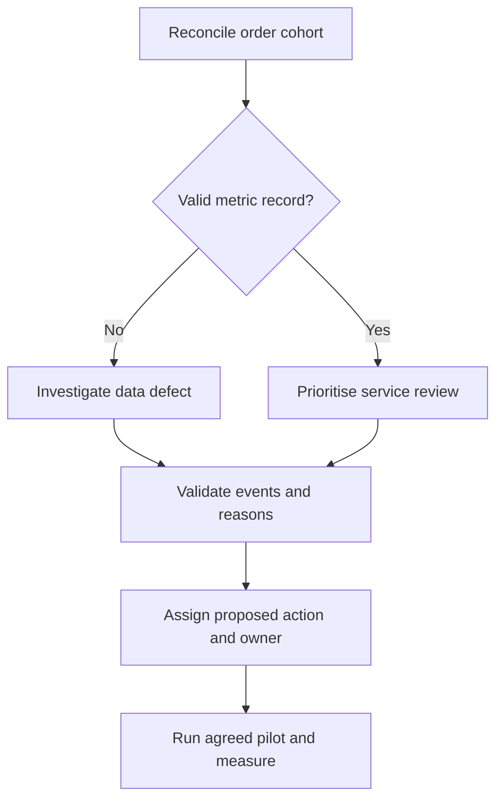

# Proposed investigation process

This process is a recommendation for discussion. The source dataset contains no evidence that it was implemented.

1. **Reconcile.** The reporting analyst confirms source integrity, one-order grain, selected period, eligibility and grouped totals.
2. **Separate evidence types.** Missing or contradictory records enter a data-quality review. Chronologically valid late records enter service investigation. Neither category automatically establishes parcel loss or carrier fault.
3. **Prioritise.** Compare late volume, eligible count, rate and duration. For state-pair comparisons, require a single seller and the stated sample threshold. Examine product, seller, seasonal and promise mix.
4. **Validate.** Obtain parcel IDs, dispatch and scan events, carrier identifiers, exception reasons and the agreed promise boundary. Verify long-duration examples against original records.
5. **Assign.** Record an agreed owner, evidence, action hypothesis, scope, due date and closure criterion. Customer communication may be reviewed separately from the physical delivery process.
6. **Pilot and monitor.** If a sponsor approves an intervention, measure comparable future cohorts and review both speed and promise lead time. Retain a baseline and track data quality and review closure.

Suggested escalation: unresolved source defects go to the data owner; incomplete fulfilment evidence to the fulfilment lead; post-handover event gaps to logistics operations; unclear customer promises to customer experience and the business sponsor. These roles are proposed, not verified assignments.
